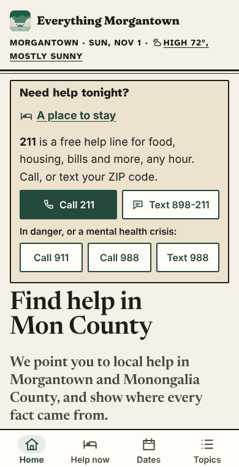
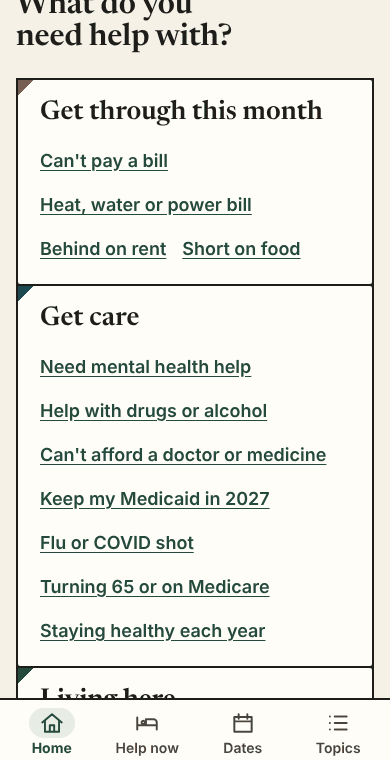
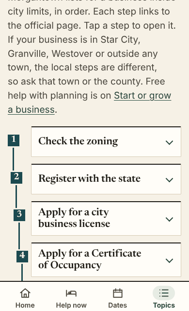
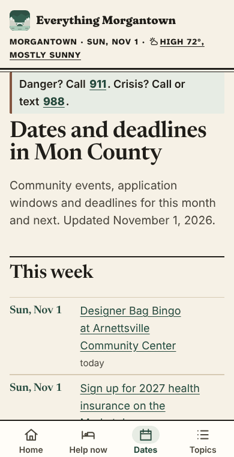
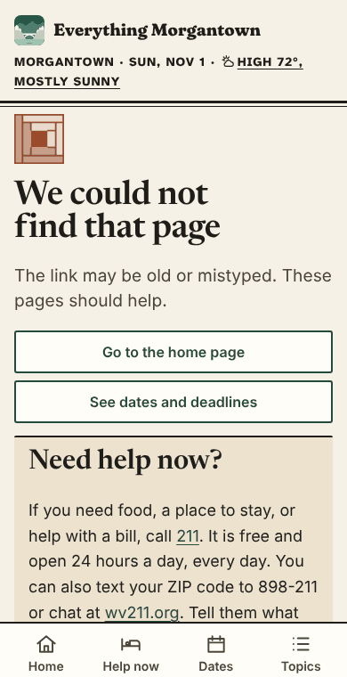
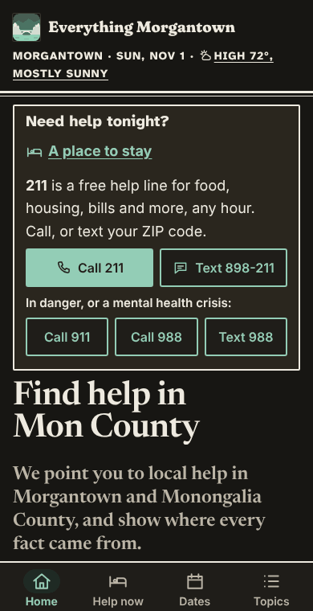

# Look: Press

Preview: [everythingmorgantown.org/?look=press](https://everythingmorgantown.org/?look=press). Part of the visual identity wave (#396), phase 2. Built November 1, 2026. Only a browser that opens that link sees it; `?look=off` goes back to normal.

## The idea

A small local paper, set by hand on a small press, or a well-kept community bulletin board. Strength comes from a serif second voice, hard printer's rules and flat inks from the Coopers Rock sandstone and hemlock palette, with quilt geometry as the one local shape.

It merges three phase 1 directions: "Broadsheet" ([generic tells](../research/2026-11-01-generic-tells-and-peers.md)), "Press" ([modern craft](../research/2026-11-01-modern-craft.md)) and "Quiet craft" ([sense of place](../research/2026-11-01-sense-of-place.md)).

| Home | Doors | Steps |
|---|---|---|
|  |  |  |

| Dates | Not found | Dark |
|---|---|---|
|  |  |  |

## Signature moves

1. **A serif second voice.** Newsreader (a newspaper face) for h1, h2, h3, card titles, door names, the home page lede and big dates. Atkinson Hyperlegible Next stays the working voice for kickers, labels and the dateline. Body stays on the system font.
2. **A masthead.** The dateline becomes a folio line in small capitals. The header closes with a thick and thin rule, the old newspaper rule, and the footer opens with the same rule. On wide screens the name is centered between rules, and the menu is a section index of plain words split by thin rules.
3. **Rules instead of soft boxes.** One radius (2px, 3px for buttons). Section heads get a 2px rule above, like a column head. Cards are paper slips with a 2px top rule.
4. **Quilt geometry as a grid.** On the home page the five doors are pieced together like quilt blocks: square patches joined by 2px seams, no icons in tinted circles.
5. **Quilt corners.** Every card and door has one half-square triangle in its top left corner, 14 to 16px, in one of three inks: rust for resources, hemlock for dates, Cheat water for places and groups. Pure CSS, no image. Never called a barn quilt.
6. **Sentence entry lines.** On door pages, "I can't pay a heat, water or power bill" and the other choices read as ruled lines with a Flying Geese triangle pointing on. On the home page, "Just moved here?" and the other questions are set in the serif.
7. **Lock steps.** On Trailhead routes the rail drops one notch to the right at each step, like the pools behind the locks and dams on the Mon. Step numbers are square gates on the rail. After step 5 the rail runs straight, so long routes never crowd the text.
8. **Dates as a printed listing.** Big serif dates with even (tabular) figures, "today" and "tomorrow" as small capitals, and the calendar's "This week" as a date column beside each title.
9. **The checked date as an imprint.** "Checked November 1, 2026" (the `span.checked` hook from #1395) is set bold in the text ink, so our hand-checking stands out from the grey source line.
10. **A Log Cabin block for "nothing here."** The site has no empty state component, so the block sits above the title of the 404 page, 56px, in rust. It is our own drawing on a plain grid (`press/log-cabin.svg`, 0.7 KB), used as a mask so it follows light and dark.

## Palette (flat inks)

Sandstone and hemlock, from the sense of place research (palette 2), plus one rust ink for marks. Text pairs were measured with the WCAG formula (the same math as `check-contrast`). Every text pair is 7:1 or more in both modes.

| Ink | Role | Light | Dark |
|---|---|---|---|
| Paper (`--bg`) | page | `#f6f1e6` | `#171613` |
| Card | card, door patch | `#fffdf8` | `#1f1d19` |
| Sandstone (`--sand`) | Help now bar, notes, season cards | `#ece2cd` | `#2a261e` |
| Pale hemlock (`--accent-bg`) | hover, crisis line | `#e7ece4` | `#1f2a24` |
| Text (`--fg`) | text, rules, seams | `#1f1d19` | `#eeeae0` |
| Muted | secondary text | `#4a453b` | `#bcb5a6` |
| Hemlock (`--accent`) | the one "act" ink: links, dates, buttons, focus | `#24493d` | `#93cdb6` |
| Cheat water (`--water`) | step rail and gates, place corners | `#1c4a50` | `#8ccbd1` |
| Rust (`--rust`) | quilt marks and Log Cabin only, never text | `#9a4b2c` | `#d98c6c` |
| Line | decorative rules | `#d6cab3` | `#3a352c` |

| Pair | Light | Dark |
|---|---|---|
| Text on paper / card / sandstone / pale hemlock | 14.94 / 16.55 / 13.08 / 14.03 | 15.06 / 14.01 / 12.54 / 12.35 |
| Muted on paper / card / sandstone / pale hemlock | 8.45 / 9.37 / 7.40 / 7.94 | 8.87 / 8.25 / 7.39 / 7.28 |
| Hemlock on paper / card / sandstone / pale hemlock | 8.90 / 9.86 / 7.79 / 8.36 | 10.04 / 9.33 / 8.35 / 8.23 |
| Card on hemlock (primary button) | 9.86 | 9.33 |
| Card on Cheat water (step numbers) | 9.63 | 9.28 |
| Rust on paper / card / sandstone (non-text) | 5.46 / 6.05 / 4.78 | 6.82 / 6.34 / 5.68 |
| Line on paper (decorative) | 1.44 | 1.49 |

No gold or yellow. Sandstone is a pale tan used only as a surface.

## Type

| Role | Face | Size |
|---|---|---|
| h1 | Newsreader 600 | 34 to 44px (home: 37 to 48px), line height 1.08 |
| h2 | Newsreader 600 | 28px |
| h3, card titles, door names, big dates | Newsreader 600 | 21 to 24px |
| Lede | system (home: Newsreader) | 19 to 21px |
| Body | system | 18px |
| Kickers, dateline, "today" | Atkinson Hyperlegible Next 800, small capitals | 14px |
| Meta, sources | system | 15.2px |

**Weight added:** Newsreader, one static cut (weight 600, optical size 48, Latin subset with kerning and figure features), **14.3 KB** woff2. The stylesheet is 14.6 KB raw, about **4.3 KB** gzipped. The Log Cabin block is 0.7 KB and loads on the 404 only. Total first visit on an everyday page: about 19 KB.

**Kept off crisis and Help now pages.** On any page with the crisis strip (Where to stay tonight, Tonight, Mental health, Drugs and alcohol, Protective orders, Leaving an unsafe home) or with the Help now tab current, headings stay in Atkinson and the serif is never downloaded (checked by watching network requests). Colors and corners still change there; the crisis strip, Quick exit and tab bar keep their layout.

The serif uses `font-display: swap` with `font-size-adjust` so a first visit shows the look rather than falling back to Georgia. For a resident rollout it should move to `optional`, like the heading face.

License: SIL Open Font License 1.1, copy at `site/public/looks/press/OFL.txt`. Source: Production Type, via the Google Fonts repository.

## What I left out, and why

- **Paper grain, ink spread, misregistration.** The brief says flat inks, and identity.md says "never from noise." The press feeling comes from rules and type alone.
- **Italic for water names** (the USGS map habit). It needs a second font file, about 14 KB more.
- **Fraunces for headings.** It is the logo face. Newsreader keeps the name special and sounds more like a local paper.
- **Drop caps, multiple columns on phones, a duotone image.** Each one was "too much" at 390px or costs weight on pages where answers come first.
- **The Where to stay tonight tiles.** That page is high stakes; its 2x2 tiles keep their shape. Only the inks change.
- **The tab bar.** Only its top edge gets firmer. Icons, pill and labels are unchanged.
- **Any round mark.** The step markers on routes were circles; here they are square.

## Known issues

- The h1 sits close under the home page Help now bar on wide screens; it could use a little more room.
- Some component styles needed a doubled class to win (`.home-band`, `.week`), because Astro scopes them with extra attributes. If this look ships, the rules belong in the components instead.
- The 404 is found by its structure (a noindex page whose main ends in the "Need help now?" note). A neutral `data-empty` hook would be sturdier.
- At 320px and 200% text the masthead dateline in capitals takes four lines. Nothing overflows, but it is tall.
- Dates on event cards wrap when a range is long ("Thu, Oct 1 to Thu, Dec 31"). They wrap cleanly but are big.
- Windows High Contrast drops the quilt corners and the masthead's thin rule on purpose.

## How it was checked

Built `main` plus the preview switch (#1392) and served `dist`. With `?look=press`:

- Screenshots at 390px and 1280px, light and dark: home, `/money/`, `/stay-tonight/`, `/legal-help/`, `/calendar/`, `/start-a-business/`, the 404.
- 320px wide with 200% text on those pages plus `/utility-bills/` and `/care/`: no horizontal scroll and no element past the edge.
- axe-core (WCAG A, AA and AAA rules) on all seven pages, both widths, both modes: no violations.
- No motion of any kind, so nothing to turn off for reduced motion.
- `check-pages`, `check-contrast`, `check-weight`, `check-label-space` and `npm test` pass (the look does not change the normal site).
