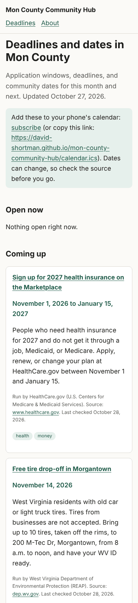
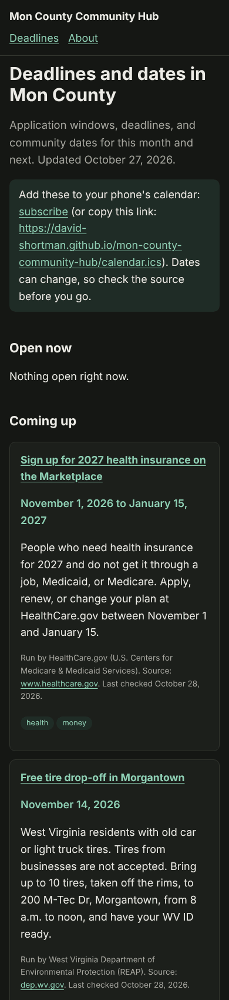
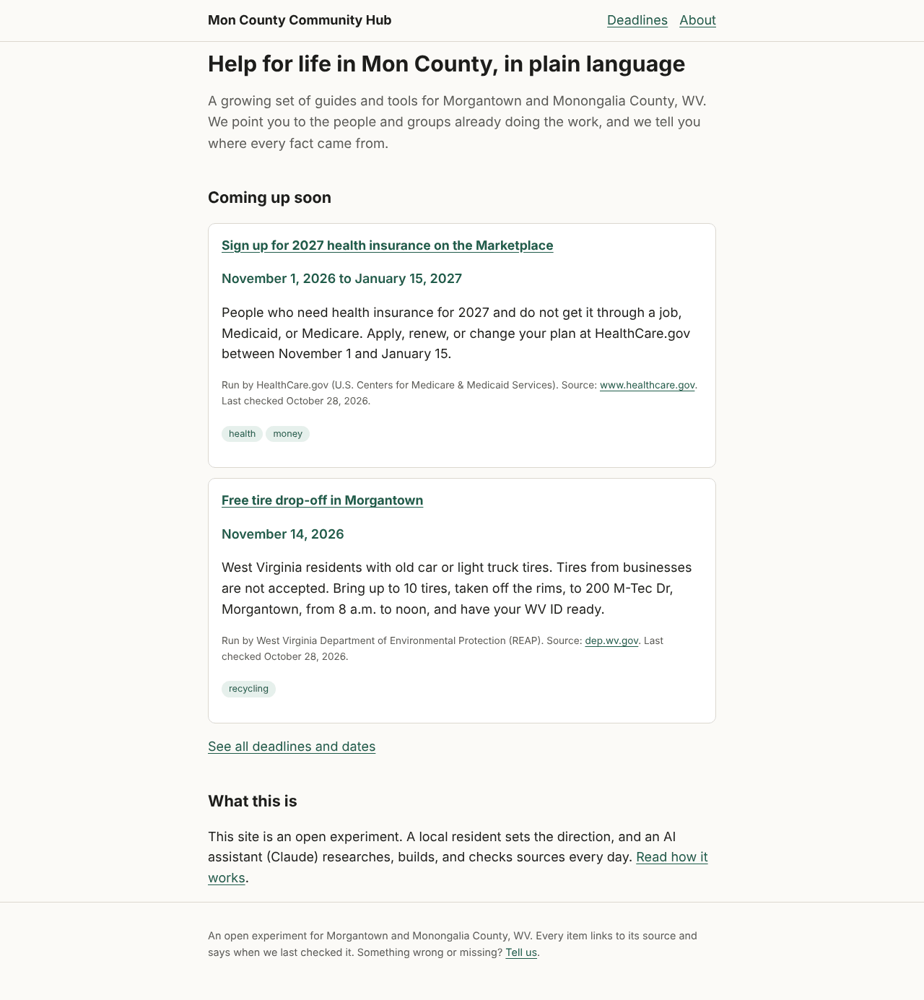

# Design review: the live site, October 28, 2026

**Reviewer:** Claude Code (design reviewer session)
**Scope:** https://david-shortman.github.io/mon-county-community-hub/ home page, `/calendar/`, `/about/`, and the `calendar.ics` feed, as deployed on October 28, 2026 (build of 03:59 UTC).
**Rubrics:** all six in [`docs/rubrics/`](../rubrics/README.md), first version.

## Summary

The site is one day old, and it is off to a strong start on the things that are hardest to add later: it is tiny and fast, it has zero automated accessibility violations, every item shows its source and checked date, and it is honest about AI. It falls short mostly on the things around the content: the calendar subscribe link does not work for many phones, empty states and errors are dead ends, reporting a problem needs a GitHub account, and some links are hard to tell apart.

| Rubric | Average | Lowest | Pass? |
|---|---|---|---|
| [Accessibility](../rubrics/accessibility.md) | 2.25 | A3, A6 at 1 | No: A3 must be at least 2 |
| [Interface and interaction](../rubrics/interface-and-interaction.md) | 1.43 | II2, II3, II6, II7 at 1 | No |
| [Visual design](../rubrics/visual-design.md) | 1.86 | VD2, VD4 at 1 | No: average under 2 |
| [Information architecture](../rubrics/information-architecture.md) | 1.13 | IA1, IA3 to IA8 at 1 | No |
| [Plain language](../rubrics/plain-language.md) | 1.71 | PL4, PL6 at 1 | No: average under 2 |
| [Trust and civic ethics](../rubrics/trust-and-civic-ethics.md) | 1.63 | TR2, TR6, TR8 at 1 | No |

No criterion scored 0. Nothing locks anyone out completely, and nothing is wrong or slanted. Several low IA scores reflect that the site has only three pages so far (no search, no browsing by topic); they will matter more as the site grows.

## Top problems, ranked by impact on residents

| Rank | Problem | Criteria | Issue |
|---|---|---|---|
| 1 | "Subscribe" uses a `webcal:` link that Android phones and Google Calendar do not handle, and events with known times (tire drop-off 8 a.m. to noon, food pantry 10 to 11:30 a.m.) import as all-day | II6, II4, II2 | #46 |
| 2 | Dead ends: "Nothing open right now." with no next step, no 211 or phone fallback anywhere, no phone links, and GitHub's default 404 page | IA1, TR6, II6 | #47 |
| 3 | The only way to report a mistake or suggest something needs a GitHub account | II7, TR8 | #48 |
| 4 | Two source links with the same name go to different pages; card titles leave the site without saying so; tags look like buttons but are not; the menu does not show the current page | A3, IA4, IA5, II2 | #49 |
| 5 | Sources and checked dates are 13.6px and faint; the accent green means too many things; menu links are 29px tall | VD2, VD4, A6 | #50 |
| 6 | "Updated October 27" sits above items "Last checked October 28"; times and deadline wording vary; no day of the week | II3, TR2, PL6 | #51 |

Lower priority, not filed yet: no `sitemap.xml`, canonical links, or schema.org `Event` data (IA8); unexplained terms like "Marketplace", "homestead exemption", and "REAP" (PL4, a content task); no browsing by topic (IA6, worth doing once there are more items).

## How the review was done

- **Matrix:** each page at 390px and 1280px wide, in light and dark color schemes (12 combinations), plus 320px for reflow.
- **Automated:** Playwright (Chromium) with [axe-core 4.10.2](https://github.com/dequelabs/axe-core) injected, tags `wcag2a, wcag2aa, wcag21a, wcag21aa, wcag22aa, best-practice`. Tab-order walk with focus outline check. Target sizes from `getBoundingClientRect()`. Accessibility tree from `ariaSnapshot()`. Forced colors and WCAG text spacing at 320px. Every network request host logged. Page weight with `curl --compressed`. Feed checked for CRLF line endings, line folding, and event types.
- **Reading level:** Flesch-Kincaid grade on page body text, with a simple vowel-group syllable count.
- **Tasks:** the seven resident tasks from the IA rubric, started from the home page.
- **Script:** [`tools/site-review.js`](tools/site-review.js) reruns the automated part.
- **Not done:** no test on a real phone or with a real screen reader; Android `webcal:` behavior is from platform documentation, not a device test. Print layout not checked.

## Screenshots

| Calendar, 390px, light | Calendar, 390px, dark | Home, 1280px, light |
|---|---|---|
|  |  |  |

On the phone, the first screen is the title, intro, the subscribe note with a three-line bare URL, and "Open now: Nothing open right now." The first actual item starts near the bottom of the screen.

## Scores and evidence

### Accessibility: average 2.25, does not pass

| ID | Criterion | Score | Evidence |
|---|---|---|---|
| A1 | Automated scan | 3 | axe found **zero violations** on all 12 page, width, and scheme combinations, including best-practice rules. |
| A2 | Keyboard and focus | 2 | Tab order is logical (brand, Deadlines, About, then content, then footer). 3px solid outline on every link in both schemes. No "Skip to main content" link. |
| A3 | Screen reader structure | 1 | Good: one `h1`, ordered headings, `header`/`nav[aria-label=Main]`/`main`/`footer`. Problems: two links both named "mountaineerfoodbank.org" go to different pages (WCAG 2.4.4); card titles link off-site with no notice; no `aria-current` in the menu; tag text runs together ("taxeshousingmoney") with no separator. |
| A4 | Contrast and color | 3 | axe contrast passes in light and dark. Body text #1d1d1b on #fbfaf7 is well above 7:1. Links are underlined, so not color-only. The About page stays usable in forced colors at 320px (screenshot checked). |
| A5 | Zoom, reflow, spacing | 2 | No sideways scroll at 320px, and none with WCAG text spacing applied. Body size is set in `px` (18px), so not a 3. |
| A6 | Target size | 1 | Menu links are 29px tall; "See all deadlines and dates" is 21px; source links 16px (inline, exempt). Passes 2.5.8 through spacing, but main navigation is under 44px. |
| A7 | Motion and media | 3 | No animations (`document.getAnimations()` is empty), no media. |
| A8 | Old phones, slow connections | 3 | Pages are 1.8 to 2.5 KB compressed, CSS inline, no JavaScript, system fonts, one request plus a favicon. Excellent. |

### Interface and interaction: average 1.43, does not pass

| ID | Criterion | Score | Evidence |
|---|---|---|---|
| II1 | Clear next step | 2 | Home and calendar purposes are clear, and items say what to do, where, and what to bring (the tire item is a model). Homestead item says "File a claim" but not how or where. |
| II2 | Controls look like what they do | 1 | Tag pills look tappable but are not. "subscribe" does not say what happens. Card titles look like they open details here but leave the site. |
| II3 | Feedback and status | 1 | "Updated October 27, 2026" above items "Last checked October 28, 2026". No "in 5 days" cues. Past items do drop off through the daily rebuild, which is good. |
| II4 | Mobile first | 2 | Comfortable at 390px, readable, no sideways scroll. But the first screen of `/calendar/` is mostly setup text and an empty "Open now" section, and nothing uses `tel:` or map links. |
| II5 | Forms | N/A | No forms on the site. |
| II6 | Errors, edge cases, empty states | 1 | `webcal:` link not handled on Android or Google Calendar. Timed events exported as all-day. "Nothing open right now." with no alternative. Made-up URLs show GitHub's default 404 ("The site configured at this address does not contain the requested file") with no link back. Feed is otherwise valid: CRLF, folded lines (max 74 octets), 7 events. |
| II7 | Ways to respond | 1 | "Tell us" and "Suggest it" go to a GitHub issue form that requires signing in. |
| II8 | Consistency | 2 | Shared layout and `EventCard`. Menu says "Deadlines", page heading says "Deadlines and dates", and the page also lists events that are not deadlines. |

### Visual design: average 1.86, does not pass

| ID | Criterion | Score | Evidence |
|---|---|---|---|
| VD1 | Hierarchy | 2 | Clear order: title, item title, date, description, fine print. Item title and date are both bold green, so they compete a little. |
| VD2 | Typography | 1 | Body 18px with about 1.6 line height and a 46rem column (comfortable). But the source and checked-date line is 13.6px and tags are 12.8px, and those are what make the site trustworthy. |
| VD3 | Spacing and layout | 2 | 16px phone gutters, cards clearly separated, holds from 320px to 1280px. Spacing values are a bit ad hoc (12, 14, 16, 18px). |
| VD4 | Color | 1 | One accent green for links, dates, tags, and the note box. |
| VD5 | Components | 2 | CSS variables for color, shared card component. Not documented yet. |
| VD6 | Dark mode | 3 | Follows the system setting, dark gray (#151714) not pure black, accents lightened (#8fd1b5), `color-scheme: light dark` set, no flash because it is pure CSS. Contrast passes. |
| VD7 | Tone | 2 | Calm, plain, nothing that looks like selling. Could feel more local. |

### Information architecture: average 1.13, does not pass

Task results, starting from the home page:

| # | Task | Found? | Steps | Notes |
|---|---|---|---|---|
| 1 | Food this week | No | | Only food item is December 12. No pointer to pantries or 211. |
| 2 | Health insurance deadline | Yes | 1 | On the home page. |
| 3 | Homestead tax break at 67 | Yes | 2 | Deadlines, then scroll. Not obvious from the label "Deadlines" that tax breaks are there. Links to state code, not the Assessor. |
| 4 | Old tires | Yes | 1 | On the home page. |
| 5 | Dates on my phone | Partly | 2 | Works on iPhone. Likely fails on Android (see #46). |
| 6 | Report a wrong date | Partly | 2 | Needs a GitHub account. |
| 7 | Who runs this | Yes | 1 | About page is clear. |

| ID | Criterion | Score | Evidence |
|---|---|---|---|
| IA1 | Task success | 1 | 4 of 7 fully, 2 partly, 1 not at all. The home page heading promises "Help for life in Mon County", which sets a broad expectation. |
| IA2 | Steps to the answer | 2 | Successful tasks average 1.5 steps. |
| IA3 | Labels | 1 | "Deadlines" covers food pantries and tire drop-offs, which residents would not call deadlines. Menu and heading differ. |
| IA4 | Navigation | 1 | Same menu on every page, but the current page is not marked. |
| IA5 | Information scent | 1 | Item titles go to other sites without saying so. Sources show bare domains; two identical ones. |
| IA6 | Grouping by need | 1 | Items have topic tags, but you cannot browse or filter by them. |
| IA7 | Search and recovery | 1 | No search, which is fine for three pages, but no fallback like 211 either. |
| IA8 | Findable from outside | 1 | Unique titles and meta descriptions on each page (good). No `sitemap.xml`, `robots.txt`, canonical links, or structured data. The `.ics` feed is a plus. |

### Plain language: average 1.71, does not pass

| ID | Criterion | Score | Evidence |
|---|---|---|---|
| PL1 | Reading level | 2 | Flesch-Kincaid grade: home 6.0, calendar 7.0, About 6.1. Under the grade 8 target. |
| PL2 | Action first | 2 | Titles are actions or things ("Sign up for 2027 health insurance", "Free tire drop-off"). First sentence says who it is for; the action comes second. No day of the week. |
| PL3 | Short sentences | 2 | Most sentences are short. Longest is 31 words, on the About page ("Every day, an AI assistant ..."). |
| PL4 | Common words | 1 | "Marketplace", "homestead property tax exemption", "REAP", and "W. Va. Code 11-6B-4" are not explained. |
| PL5 | Speak to the reader | 2 | Mostly direct verbs ("Bring", "Go", "Enroll"), but items open in third person ("People who need ...", "Homeowners who are ..."). |
| PL6 | Numbers, dates, times | 1 | "8 a.m. to noon" vs "10:00 to 11:30 a.m."; "on or before December 1" vs "by December 15"; no weekdays. |
| PL7 | Style rules | 2 | No em or en dashes on any page or in the feed. Sentence case headings. A bare URL in body text on `/calendar/`. |

### Trust and civic ethics: average 1.63, does not pass

| ID | Criterion | Score | Evidence |
|---|---|---|---|
| TR1 | Sources and dates visible | 2 | Every card shows "Run by", a source link, and "Last checked". Source shows as a domain, and nothing flags stale items yet. |
| TR2 | Accuracy and freshness | 1 | Items were not checked against their sources in this review (that is the Findability scout's and #16's job). The page date is a day earlier than item checked dates (#51). The page shows 62 days and the feed shows more (7 vs 5 items), which is fine but not explained. |
| TR3 | Neutrality | 2 | Neutral throughout. The city election item (in the feed) points to the City of Morgantown's official page. How items are chosen and ordered is not stated. |
| TR4 | Privacy | 2 | Only one host contacted (`david-shortman.github.io`); no trackers, fonts, or scripts. About says "We don't track you." Nothing warns that reports via GitHub are public. |
| TR5 | Honesty about AI | 2 | Home and About name Claude and Anthropic and the human's role. Items do not say how each was checked. |
| TR6 | Points to real people | 1 | Organizations are named and linked, but no phone numbers show, the homestead item does not link the Assessor, and there is no fallback for people without internet. |
| TR7 | No dark patterns | 2 | None found. The calendar subscription does not say how to remove it. |
| TR8 | Open and accountable | 1 | About explains who and why and links the charter and decision log. Corrections need a GitHub account. |

## What is already good (keep it)

- **Weight and speed.** About 2 KB per page with no JavaScript. This is ideal for rural connections and old phones. Future features should protect this.
- **Clean accessibility base.** Zero axe violations, visible focus, landmarks, and real underlined links.
- **Sources everywhere.** Every item says who runs it, where the fact came from, and when it was checked.
- **Honest framing.** The site says plainly that it is an experiment, that an AI does the work, and that a resident sets direction.
- **Dark mode done right** with adjusted colors, not an inversion.
- **Item copy.** The tire drop-off item is a model: who, what, where, when, what to bring, and what is not accepted.

## Next review

Rerun after #46 to #51 close, or in two weeks, whichever comes first. Use the same task set so scores compare.
