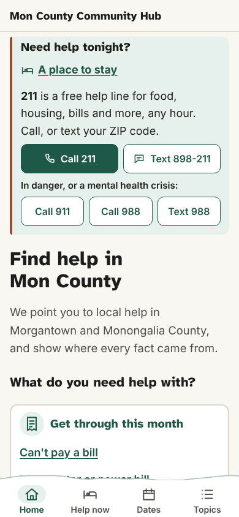
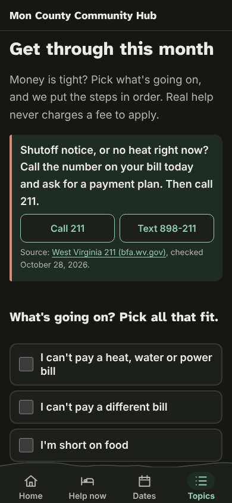
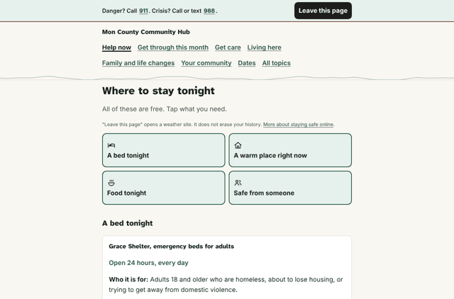

# Design review: the door pages, October 30, 2026

**Reviewer:** Claude Code (design reviews and checks session)
**Scope:** the site as built from `main` on October 30, 2026 (after #338 and #341), served locally. 13 pages: home, `/stay-tonight/`, the four doors (`/care/`, `/money/`, `/living-here/`, `/family/`), `/topics/`, `/search/`, `/calendar/`, `/about/`, and three answer pages (`/utility-bills/`, `/snap/`, `/recycling/`).
**Rubrics:** all six in [`docs/rubrics/`](../rubrics/README.md). Same seven resident tasks as the [first review](2026-10-28-site.md), so scores compare.

## Summary

The site went from 3 pages to 26 in two days and was reorganized around Help now and five doors. It now passes all six rubrics; on October 28 it passed none. Zero automated accessibility problems on 78 page, width and color scheme combinations. No page scrolls sideways at 320px, even with text at 200%. Pages are 7 to 13 KB compressed. Every task but one can be done in one or two taps.

What still holds it back: reporting a mistake still needs a GitHub account (#48), the source and checked-date lines are still the smallest text on the page (#50, #327), and a few sentences run past 30 words.

| Rubric | Oct 28 | Oct 30 | Lowest now | Pass? |
|---|---|---|---|---|
| [Accessibility](../rubrics/accessibility.md) | 2.25 | **2.63** | A3, A5, A6 at 2 | Yes |
| [Interface and interaction](../rubrics/interface-and-interaction.md) | 1.43 | **2.13** | II7 at 1 | Yes |
| [Visual design](../rubrics/visual-design.md) | 1.86 | **2.29** | VD2 at 1 | Yes |
| [Information architecture](../rubrics/information-architecture.md) | 1.13 | **2.50** | IA1, IA3, IA5, IA8 at 2 | Yes |
| [Plain language](../rubrics/plain-language.md) | 1.71 | **2.29** | PL3 at 1 | Yes |
| [Trust and civic ethics](../rubrics/trust-and-civic-ethics.md) | 1.63 | **2.25** | TR8 at 1 | Yes |

No criterion scored 0.

## Top problems, ranked by impact on residents

| Rank | Problem | Criteria | Issue |
|---|---|---|---|
| 1 | Reporting a wrong fact still needs a GitHub account | II7, TR8 | #48 (open) |
| 2 | Source and checked-date lines are 13.6px, the smallest text on most pages | VD2, TR1 | #50, #327 (open) |
| 3 | A homeowner turning 65 does not find the homestead tax break from the Turning 65 page | IA1, IA5 | #346 (new) |
| 4 | Sentences of 31 to 47 words on `/utility-bills/`, `/money/` and `/stay-tonight/`; two are checklists written as one sentence | PL3 | #134 (open), #347 (new) |
| 5 | On a phone, `/calendar/` opens with the "Add to your calendar" box, so the first date is below the first screen | II4 | #199 (open) |
| 6 | Tab bar labels do not grow with the reader's text size | A5 | #311 (open) |
| 7 | Menu says "Dates", the page says "Deadlines and dates" | IA3, II8 | #101 (open) |

Smaller notes, not filed: on phones, door pages and answer pages light up the "Topics" tab (on desktop the door itself is marked, which is clearer). "Your community" in the desktop menu jumps to a section of `/topics/` because that door is not built yet (#252). No schema.org data yet (#37).

## How the review was done

- **Matrix:** 13 pages at 320px, 390px and 1280px wide, in light and dark (78 combinations).
- **Automated:** Playwright (Chromium) with axe-core 4.10.2, tags `wcag2a, wcag2aa, wcag21a, wcag21aa, wcag22aa, best-practice`. Tab-order walk at 390px. Target sizes from `getBoundingClientRect()` (inline links in sentences left out, since WCAG exempts them). Sideways scroll at 320px with 100% and 200% text on all 26 pages. Smallest text size in `main`. Every network request host logged. Page weight with `gzip -9`.
- **Reading level:** Flesch-Kincaid grade on the main text, simple vowel-group syllable count.
- **Tasks:** the seven resident tasks, started from the home page on a 390px phone.
- **Script:** [`tools/site-review.js`](tools/site-review.js) reruns the automated part against a built `site/dist`.
- **Not done:** no real phone, no real screen reader, no print check.

## Screenshots

| Home, 390px, light | Get through this month, 390px, dark | Where to stay tonight, 1280px, light |
|---|---|---|
|  |  |  |

## Scores and evidence

### Accessibility: average 2.63, passes

| ID | Criterion | Score | Evidence |
|---|---|---|---|
| A1 | Automated scan | 3 | axe found **zero violations** on all 78 combinations, including best-practice rules. |
| A2 | Keyboard and focus | 3 | "Skip to main content" is the first stop on every page. On `/stay-tonight/` the next stops are 911, 988 and "Leave this page", before the menu. 3px solid outline on every stop. |
| A3 | Screen reader structure | 2 | One `h1` per page, headings in order, `aria-current` on the menu, screen-reader-only context on buttons ("Call 211, West Virginia 211"). Some door buttons repeat long context ("Call 988, Call or text 988 in a mental health crisis"), which is wordy when heard. |
| A4 | Contrast and color | 3 | The build checks every color pair (`check-contrast.mjs`): text at 7:1 or more in both schemes. Links are underlined. |
| A5 | Zoom, reflow, spacing | 2 | No sideways scroll on any of 26 pages at 320px with 100% or 200% text (#332 fixed by #338). Tab bar labels stay fixed size (#311). |
| A6 | Target size | 2 | Menu tabs, buttons and door choices are 44px or taller; the two standalone links fixed in #341 are 44px. Links in lists (`/topics/`, "Often goes with this") are 21px tall but well spaced, so they pass WCAG 2.5.8. Checkboxes are 24px inside 56px tall labels. |
| A7 | Motion and media | 3 | No animations or transitions in the layout, no media. |
| A8 | Old phones, slow connections | 3 | 7.2 KB (`/topics/`) to 12.7 KB (`/calendar/`) compressed, CSS inline, plus one 11 KB font. Only the site's own host is contacted. Search loads its index only when used. |

### Interface and interaction: average 2.13, passes

| ID | Criterion | Score | Evidence |
|---|---|---|---|
| II1 | Clear next step | 3 | Every door opens with "What's going on? Pick all that fit." and a "Show my steps" button; Help now opens with four big choices. Call and Text buttons sit next to the problem they solve. |
| II2 | Controls look like what they do | 2 | Buttons look like buttons and links are underlined. Door choices are real checkboxes in large labels. Tags no longer look like buttons. |
| II3 | Feedback and status | 2 | Date chips with weekday and "in 3 days" labels kept current by a small script. "Updated" on `/calendar/` is today. Date wording still varies a little (#51, #142). |
| II4 | Mobile first | 2 | Thumb tab bar, Call and Text buttons, crisis strip first on crisis pages. `/calendar/` still opens with setup, not dates (#199). |
| II5 | Forms | 2 | Search and the door picker have visible labels and work by keyboard. With no script, the picker shows plain links to each situation's page instead. |
| II6 | Errors, edge cases, empty states | 2 | Search with no results and search that fails to load both point to the topic list and 211. The 404 page has the 211 box. Door pages with no dates say so and link all dates. |
| II7 | Ways to respond | 1 | "Tell us" still opens a GitHub form that needs an account (#48). |
| II8 | Consistency | 2 | One door page template, shared buttons and cards. "Dates" vs "Deadlines and dates" (#101). |

### Visual design: average 2.29, passes

| ID | Criterion | Score | Evidence |
|---|---|---|---|
| VD1 | Hierarchy | 2 | Clear order on every door: title, short intro, the urgent box, then choices. On the home phone screen the Help now box comes before the `h1`, by design (#250). |
| VD2 | Typography | 1 | Body 18px, headings in Atkinson Hyperlegible. Source and checked-date lines are still 13.6px on 11 of 13 pages (#50, #327). |
| VD3 | Spacing and layout | 2 | 16px phone gutters, cards clearly separated, holds from 320px to 1280px. |
| VD4 | Color | 2 | Brick red is kept for crisis boxes, and tags are gone. Green still means links, buttons and date chips (the date-chip part of #50). |
| VD5 | Components | 3 | Shared door page, action buttons, crisis strip and cards, documented in `docs/design/presentation.md`. |
| VD6 | Dark mode | 3 | Follows the system setting, adjusted colors (not inverted), every screen checked in dark at three widths. |
| VD7 | Tone | 3 | Calm and local: ridgeline header, plain icons, nothing that looks like selling. |

### Information architecture: average 2.50, passes

Task results, starting from the home page on a phone:

| # | Task | Oct 28 | Oct 30 | Steps | Notes |
|---|---|---|---|---|---|
| 1 | Food this week | No | Yes | 1 | "Short on food" on the home page. |
| 2 | Health insurance deadline | Yes | Yes | 1 | "Coming up" on the home page. |
| 3 | Homestead tax break at 67 | Yes | Yes | 2 | Get through this month, then "Dates for this", or the Dates tab. Not on `/turning-65/` (#346). |
| 4 | Old tires | Yes | Yes | 2 | Living here, then "I have tires or electronics". The next tire date shows on `/recycling/`. |
| 5 | Dates on my phone | Partly | Yes | 2 | Dates tab, then iPhone, Google or Outlook buttons. |
| 6 | Report a wrong date | Partly | Partly | 1 | "Tell us" needs a GitHub account (#48). |
| 7 | Who runs this | Yes | Yes | 1 | "About this site" in the footer. |

| ID | Criterion | Score | Evidence |
|---|---|---|---|
| IA1 | Task success | 2 | 6 of 7 fully, 1 partly. |
| IA2 | Steps to the answer | 3 | Successful tasks average 1.5 taps. |
| IA3 | Labels | 2 | Doors and choices are in residents' words ("Can't pay a bill", "I have tires to get rid of"). "Dates" vs "Deadlines and dates" (#101). |
| IA4 | Navigation | 3 | Same tab bar everywhere, current place marked, breadcrumbs on answer pages. |
| IA5 | Information scent | 2 | Choices say what you get. A few dead-end paths for a resident's situation (homestead from Turning 65, #346). |
| IA6 | Grouping by need | 3 | Five doors, a pick-what-fits list per door, and `/topics/` by door and A to Z (#102 closed). |
| IA7 | Search and recovery | 3 | Pagefind search on every page, empty results point to 211 and topics (#76 closed). |
| IA8 | Findable from outside | 2 | Sitemap, `robots.txt`, canonical links, `llms.txt`, unique titles. No schema.org data yet (#37). |

### Plain language: average 2.29, passes

| ID | Criterion | Score | Evidence |
|---|---|---|---|
| PL1 | Reading level | 3 | Flesch-Kincaid grade 1.5 (`/search/`) to 7.3 (`/utility-bills/`); doors 3.7 to 5.3. |
| PL2 | Action first | 3 | Doors and Help now lead with what to do ("Call the number on your bill today"). |
| PL3 | Short sentences | 1 | Sentences of 31 to 47 words on `/utility-bills/` (#134), `/money/` and `/stay-tonight/` (#347). |
| PL4 | Common words | 2 | Most terms explained ("SNAP (food stamps)", "LIEAP"). Some still are not (#103, #326). |
| PL5 | Speak to the reader | 2 | Doors say "you" and "I". Calendar entries still open in third person ("Homeowners who are ..."). |
| PL6 | Numbers, dates, times | 2 | Weekdays on date chips. Some time formats still vary (#51, #142). |
| PL7 | Style rules | 3 | No em or en dashes on any built page. Sentence case headings. |

### Trust and civic ethics: average 2.25, passes

| ID | Criterion | Score | Evidence |
|---|---|---|---|
| TR1 | Sources and dates visible | 2 | Every card and urgent box has a source and checked date, but in small text, and some sources show only a web address (#327). |
| TR2 | Accuracy and freshness | 2 | The 211 box on `/snap/`, `/calendar/` and 404 now reads from the data (#149). Items were not re-checked against sources in this review. |
| TR3 | Neutrality | 2 | Neutral throughout. How items are chosen and ordered is not yet stated (#38). |
| TR4 | Privacy | 3 | Only the site's own host; no trackers. `/search/` says the host can see which files load. Quick exit says plainly it does not erase history. |
| TR5 | Honesty about AI | 2 | About names the AI and the human in charge. Items do not say how each was checked. |
| TR6 | Points to real people | 3 | Call and Text buttons on every door, 211 on every page, named organizations with phone numbers. |
| TR7 | No dark patterns | 3 | None found. Calendar page explains how to unsubscribe. |
| TR8 | Open and accountable | 1 | Corrections still need a GitHub account (#48). |

## What is already good (keep it)

- **Light and fast** at about 10 KB per page, with no third-party hosts.
- **Zero axe violations** across all pages, widths and color schemes.
- **Help first:** 211, 988 and 911 are one tap away on every page, and the crisis page has a quick exit that works without script.
- **Residents' words:** doors and choices name situations, not programs.

## Next review

After #48 and #50 close, or by November 13, whichever comes first. Use the same tasks. Once axe runs in CI (#105), A1 is checked on every PR, so the next review can spend its time on the human checks.
